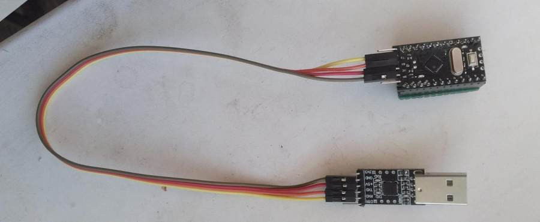
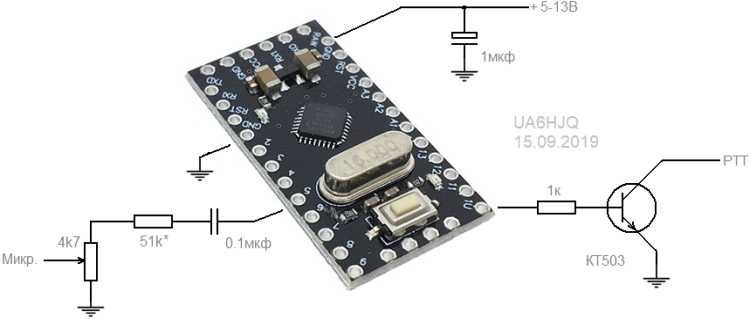
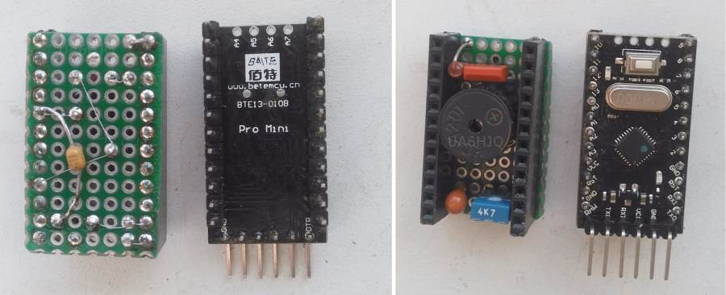

Это простой телеграфный маяк, собран на плате Arduino Pro Mini (Atmega168 5В 16мГц), пригодится для репитера или маяка.

За основу взят скетч IN3GJH, я добавил управление PTT и txdelay (задержка между нажатием PTT и началом передачи звука), которая нужна для портативок с включенным экономайзером.

Скетч будет работать и на платах с ATmega328. Напряжение на плату подаётся в пределах 5-13В. При передаче, вместе со звуком, мигает встроенный светодиод. 

Текст задаётся в строке: `sendMsg("R7HJ LN05XA");` 
Интервал передачи: `#define PAUSE (600000UL)`

Для контроля работы маяка, можно к выводу 5 подключить зуммер с последовательно включенным резистором 500 ом. Если нужен только VOX транзистор (кт503) и резистор (1ком) - не устанавливайте.

Подстроечным резистором устанавливаем девиацию 2.5кГц, для ЧМ радиостанции. Номиналы деталей не критичны и могут отличаться от приведённых на схеме.
